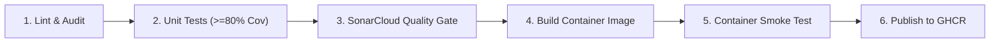

# Server Health Monitor API

[](https://github.com/chandanajn/server-health-monitor-tool/actions/workflows/ci.yml)
[](https://sonarcloud.io/summary/new_code?id=chandanajn_server-health-monitor-tool)
[](https://sonarcloud.io/summary/new_code?id=chandanajn_server-health-monitor-tool)

A production-grade FastAPI application that continuously monitors server log files across enterprise environments (e.g. dev, staging, prod), tracks active faults using incremental byte offsets, persists checkpoints atomically, and provides health reports and operational resolution through REST APIs.

```mermaid
flowchart LR
    subgraph Storage ["Log Storage"]
        Logs["Server Logs (/data/org)"]
    end

    subgraph Service ["Monitoring Service Core"]
        Engine["Monitor Engine (Seek to Offset)"]
        State["Atomic Checkpoint Store (state.json)"]
        Cache["In-Memory Snapshot"]
        API["FastAPI HTTP Router"]
    end

    subgraph Clients ["Clients & Observability"]
        Operator["DevOps / Operations"]
        Metrics["Prometheus Scraper"]
    end

    Logs -->|Incremental Byte Seek| Engine
    Engine -->|Atomic State Persist| State
    Engine -->|Synchronized Snapshot Update| Cache
    Operator -->|GET /api/v1/report| API
    Operator -->|POST /api/v1/resolve| API
    Metrics -->|GET /metrics| API
    API -->|Serve Instantly (Lockless)| Cache
    API -->|Append RESOLVED Line| Logs
```

---

## Prerequisites

- **Python**: Version 3.11 or higher
- **Git**: For version control
- **Docker**: Engine 24.0+ / Docker Desktop for containerized deployment
- **SonarCloud**: Account for CI quality gate analysis (optional for local runs)

---

## Setup and Local Run

### 1. Environment Setup

Clone the repository and set up a virtual environment:

```powershell
# Windows PowerShell
python -m venv .venv
.\.venv\Scripts\Activate.ps1
python -m pip install --upgrade pip
pip install -r requirements.txt -r requirements-dev.txt
pip install -e . --no-deps
```

### 2. Configuration (`.env`)

Copy the example configuration:

```powershell
Copy-Item .env.example .env
```

Default configuration variables:

```ini
HM_ROOT=org
HM_STATE_FILE=state/state.json
HM_SCAN_INTERVAL_SEC=10.0
HM_MIN_SEVERITY=ERROR
HM_HOST=0.0.0.0
HM_PORT=8000
HM_LOG_LEVEL=INFO
HM_LOG_FORMAT=text
HM_API_KEY=dev-secret-key-12345
HM_ENABLE_METRICS=true
```

### 3. Run Application

```powershell
python -m health_api
```

The service initializes, runs an initial scan across `org/`, and starts serving at `http://127.0.0.1:8000`.

---

## Log Format and Fault Resolution

### Log Format

The monitor engine parses server log files with the format:

```text
YYYY-MM-DDTHH:MM:SS SEVERITY [id=FAULT_ID] Log message text
```

Examples:
- `2026-10-08T09:02:00 ERROR [id=F001] Database unavailable`
- `2026-10-08T09:05:00 WARN High memory usage`
- `2026-10-08T09:06:00 CRIT [id=F002] Disk failure`

### Resolving a Fault

An active fault can be resolved in two ways:

1. **Manual File Edit**: Append an `INFO RESOLVED` record directly to the server log file:
   ```text
   2026-10-08T09:15:00 INFO RESOLVED [id=F001] Database restored
   ```
2. **API Resolution**: Send an authenticated `POST` request to the resolve endpoint:
   ```powershell
   Invoke-RestMethod -Method POST `
     -Uri "http://127.0.0.1:8000/api/v1/servers/dev/server-2.log/faults/F001/resolve" `
     -Headers @{"X-API-Key" = "dev-secret-key-12345"}
   ```
   The API atomically appends the resolution line directly to the server's log file and triggers an immediate rescan.

---

## Configuration Reference

| Environment Variable | Type | Default | Description |
| :--- | :--- | :--- | :--- |
| `HM_ROOT` | string | `org` | Root directory containing monitored server logs |
| `HM_STATE_FILE` | string | `state/state.json` | Path to persistent checkpoint state JSON file |
| `HM_SCAN_INTERVAL_SEC` | float | `10.0` | Background rescan polling interval (seconds, min: 0.1) |
| `HM_MIN_SEVERITY` | string | `ERROR` | Minimum severity threshold (`WARN`, `ERROR`, `CRIT`) |
| `HM_HOST` | string | `0.0.0.0` | HTTP listener bind host |
| `HM_PORT` | int | `8000` | HTTP listener bind port (1-65535) |
| `HM_LOG_LEVEL` | string | `INFO` | Application logging level (`DEBUG`, `INFO`, `WARN`, `ERROR`) |
| `HM_LOG_FORMAT` | string | `text` | Logging output format (`text` or `json`) |
| `HM_API_KEY` | string | `None` | Optional API key for write routes (min 16 characters) |
| `HM_ENABLE_METRICS` | bool | `true` | Expose Prometheus metrics at `/metrics` |

---

## API Reference

All error responses use the standard JSON envelope: `{"error": {"code": "...", "message": "...", "request_id": "..."}}`.

| Method | Endpoint | Auth | Description | Example (PowerShell) |
| :--- | :--- | :--- | :--- | :--- |
| `GET` | `/healthz` | None | Process liveness probe | `Invoke-RestMethod http://127.0.0.1:8000/healthz` |
| `GET` | `/readyz` | None | Service readiness probe | `Invoke-RestMethod http://127.0.0.1:8000/readyz` |
| `GET` | `/api/v1/report` | None | Health summary & affected servers | `Invoke-RestMethod http://127.0.0.1:8000/api/v1/report` |
| `GET` | `/api/v1/servers` | None | Paginated server list (`?env=&status=&limit=&offset=`) | `Invoke-RestMethod "http://127.0.0.1:8000/api/v1/servers?limit=10"` |
| `GET` | `/api/v1/servers/{env}/{server}` | None | Detailed server health & active faults | `Invoke-RestMethod http://127.0.0.1:8000/api/v1/servers/dev/server-2.log` |
| `GET` | `/api/v1/faults` | None | Flat list of active faults (`?severity=&env=`) | `Invoke-RestMethod "http://127.0.0.1:8000/api/v1/faults?severity=CRIT"` |
| `POST` | `/api/v1/scan` | Required | Trigger immediate manual scan cycle | `Invoke-RestMethod -Method POST http://127.0.0.1:8000/api/v1/scan -Headers @{"X-API-Key"="dev-secret-key-12345"}` |
| `POST` | `/api/v1/servers/{env}/{server}/faults/{id}/resolve` | Required | Append resolution line & clear fault | `Invoke-RestMethod -Method POST http://127.0.0.1:8000/api/v1/servers/dev/server-2.log/faults/F001/resolve -Headers @{"X-API-Key"="dev-secret-key-12345"}` |
| `GET` | `/metrics` | None | Prometheus scrape metrics endpoint | `Invoke-RestMethod http://127.0.0.1:8000/metrics` |

---

## Running Tests and Code Quality

```powershell
# Run Ruff linting
ruff check .

# Check formatting
ruff format --check .

# Strict type checking
mypy src tests scripts

# Run full pytest suite with branch coverage validation
pytest --cov=health_api --cov-report=term-missing --cov-report=xml --cov-fail-under=80

# Audit dependencies for known vulnerabilities
pip-audit -r requirements.txt
```

---

## Running in Docker

The application includes a hardened multi-stage `Dockerfile` based on `python:3.11-slim-bookworm`:
- Non-root execution as fixed UID/GID 10001 (`appuser`)
- Pre-configured directories: `/data/org` (monitored logs) and `/data/state` (checkpoints)
- Internal `HEALTHCHECK` probe using standard library `urllib`

### Build Image

```powershell
docker build -t health-api:local .
```

### Run Container Smoke Test

Verify all 6 operational scenarios against the built image:

```powershell
python scripts/smoke_test.py health-api:local
```

### Run Service with Volumes

```powershell
# For read-only log monitoring:
docker run --rm -p 8000:8000 `
  -v "${PWD}\org:/data/org:ro" `
  -v "${PWD}\state:/data/state:rw" `
  -e HM_API_KEY="production-secret-key-12345" `
  health-api:local

# For API-driven fault resolution (requires writable log mount):
docker run --rm -p 8000:8000 `
  -v "${PWD}\org:/data/org:rw" `
  -v "${PWD}\state:/data/state:rw" `
  -e HM_API_KEY="production-secret-key-12345" `
  health-api:local
```

---

## CI/CD Pipeline Architecture

The automated pipeline is defined in `.github/workflows/ci.yml` and consists of 6 sequential stages:



1. **Stage 1 (Lint)**: Ruff linter, Ruff format verification, strict MyPy type checking, and pip-audit vulnerability checks.
2. **Stage 2 (Test)**: Full pytest suite with strict branch coverage enforcement (`--cov-fail-under=80`) and `coverage.xml` export.
3. **Stage 3 (Sonar)**: SonarCloud quality gate enforcement (`-Dsonar.qualitygate.wait=true`). Enforces zero code smells and branch coverage standards on repository runs.
4. **Stage 4 (Build)**: Docker Buildx builds the production container with OCI metadata (`VCS_REF`, `BUILD_DATE`, `VERSION`) and exports `image.tar`.
5. **Stage 5 (Smoke)**: Loads `image.tar` and executes `scripts/smoke_test.py` verifying all 6 end-to-end operational scenarios against the container.
6. **Stage 6 (Publish)**: Gated exclusively to `main` branch pushes and `v*` release tags. Checks cryptographic tag immutability via `docker manifest inspect` and pushes to `ghcr.io`.

### Pulling the Published Image

```powershell
docker pull ghcr.io/chandanajn/server-health-monitor-tool:latest
docker run --rm -p 8000:8000 -v "${PWD}\org:/data/org:ro" ghcr.io/chandanajn/server-health-monitor-tool:latest
```

---

## Design Decisions

1. **Snapshot Reads**: All read API requests are served from an in-memory snapshot cache protected by reader locks. Requests never block on disk I/O.
2. **Atomic State Checkpoints**: Checkpoints write to a unique temporary file (`state.json.tmp.<uuid>`), flush to disk (`fsync`), and atomically replace `state.json` to prevent partial or corrupted writes.
3. **Incremental Byte Offsets**: File offsets and inode tracking allow the scanner to seek directly to unread bytes without re-parsing entire log files.
4. **Log Rotation & Truncation**: Detected via inode changes and size decreases, automatically resetting read offsets while preserving active fault states.
5. **Single Worker Uvicorn**: Uvicorn runs with a single worker process because the checkpoint store is designed for a single writer.

---

## Operational Assumptions

1. **Log Timestamps**: Assumed to be ISO-8601 strings (e.g. `YYYY-MM-DDTHH:MM:SS`).
2. **Line Delimiters**: Monitored log files use standard newline delimiters (`\n` or `\r\n`). Trailing partial lines without newlines are buffered until the next scan cycle.
3. **Unique Fault IDs**: Fault IDs (`[id=FAULT_ID]`) are unique per monitored server file.
4. **Single Writer**: Exactly one monitoring service instance writes to a given `state.json` file.

---

## Known Limitations and Accepted Risks

1. **Polling Delay**: File changes are detected on the next background scan interval (`HM_SCAN_INTERVAL_SEC`), not via instant kernel filesystem notifications (`inotify`).
2. **API Fault Resolution**: Requires the underlying log volume mount to be writable (`:rw`). If mounted read-only (`:ro`), resolution attempts return a unified 503 error (`log_not_writable`).
3. **Single API Key**: Authentication uses a single shared secret key without role-based access control (RBAC).

---

## Troubleshooting

| Problem | Root Cause | Solution |
| :--- | :--- | :--- |
| **Permission denied on state file** | Container UID 10001 cannot write to host mount directory | Grant write permissions to UID 10001 (`chmod 777 state` on host or `chown -R 10001:10001 state`). |
| **`/readyz` returns 503** | Initial scan has not finished or scans are failing | Verify `HM_ROOT` exists and contains readable log files. Check `/healthz` for process liveness. |
| **Fault resolution returns 503** | Log file is mounted read-only in Docker | Ensure log directory mount specifies read-write permissions (`-v /path/to/org:/data/org:rw`). |
| **SonarCloud 0% coverage** | Coverage report missing or path mismatch | Confirm `coverage.xml` is generated during pytest and referenced in `sonar-project.properties`. |
| **Quarantined checkpoint** | Corrupted state JSON detected on startup | The service safely moves corrupted files to `state.json.corrupt.<timestamp>` and starts with a clean state. |

---

## Development

### 1. Repository Setup
Created the Git repository and set up the initial project configuration. Added `.gitignore` to exclude virtual environments, Python cache files, and local state files. Also configured Git to handle line endings consistently.

### 2. Project Structure and Dependencies
Set up the project using a `src` directory structure and configured dependencies in `pyproject.toml`. Added separate development dependencies and lockfiles.

Created sample log directories for `dev`, `prd`, and `staging` environments. Added sample server logs to test the monitoring functionality.

Verified the project installation and ran the initial code checks using Ruff, Ruff formatter, and MyPy. All checks passed.

### 3. Domain Models and Log Parser
Added the initial models required for monitoring, including severity levels, log events, faults, file checkpoints, server status, and scan reports.

Implemented the log parser to read server log entries and identify their severity and details. Added support for resolving faults through explicit `INFO RESOLVED` log entries.

The parser also handles invalid log entries without stopping the application. Added basic validation for timestamps, resolution entries, and input length. Invalid entries are handled safely, with a limited preview retained for debugging.

Added unit tests to cover different severity levels, timestamp formats, fault resolution entries, invalid inputs, and boundary cases.

### 4. Checkpoint Store
Implemented state persistence using an atomic write mechanism. File offsets and active faults are saved together to a temporary file, flushed with fsync, and swapped in place using an atomic replace operation to prevent partial or corrupted writes during unexpected shutdowns.

Added strict schema validation on load to ensure file paths are safe relative paths and fault IDs are consistent. If a state file is found to be malformed or corrupted, it is automatically moved to a timestamped quarantine file rather than crashing the service, allowing monitoring to continue safely with a fresh state.

Added unit tests to verify save and reload roundtrips, unchanged state write avoidance, corrupt file quarantine handling, schema version checks, and path traversal protection.

### 5. Monitor Engine
Built the core log monitoring engine that traverses the log directory tree and tracks active server faults. It scans files incrementally, seeking to saved byte offsets rather than reading full log files repeatedly.

Added file rotation and truncation detection using inode and file size tracking. If a log file shrinks or changes inode, the offset resets to the beginning while retaining any existing active faults. Incomplete trailing lines without newlines are held back until the next scan cycle. If an error occurs on a single file, it is isolated and recorded without interrupting the scan for other servers.

Added unit tests covering baseline metrics against sample logs (6 servers, 3 faulty at ERROR, 4 faulty at WARN), incremental appends, partial-line buffering, log rotations, vanished files, and the full fault resolution lifecycle.

### 6. Settings and Logging
Implemented environment-based configuration using Pydantic Settings with the HM_ prefix. Added validation rules ensuring the root log directory exists, the state file path is located outside the monitored root directory, the scan interval is at least 0.1 seconds, and the optional API key has a minimum length of 16 characters.

Configured application logging supporting both human-readable text and structured single-line JSON formatting. Added context variable tracking so request identifiers can be propagated to all log records for end-to-end tracing.

Added unit tests to verify default configuration values, environment variable overrides, .env file loading with environment precedence, validation failure cases, and structured JSON log formatting.

### 7. Application Factory and Health Endpoints
Created the FastAPI application factory using an asynchronous lifespan context manager. On startup, the service runs an initial scan and starts a background monitoring task that periodically rescans the log tree. On shutdown, it stops the background task cleanly and saves state to disk.

Built the service coordinator layer with thread-safe locking to keep scan cycles and file persistence synchronized. Added an in-memory snapshot cache so read queries can be answered instantly without accessing the disk.

Implemented health check probe endpoints: `/healthz` for process liveness and `/readyz` for readiness, verifying that the initial scan has completed and that the most recent scan is not stale. Added unit tests for health endpoints, lifespan startup/shutdown, and stale state detection.

### 8. Read REST API Endpoints
Defined Pydantic schemas and implemented read endpoints under `/api/v1` for operational reporting, server queries, and active faults. All read operations serve directly from the in-memory snapshot without touching disk files.

Added `/api/v1/report` to return total and faulty server counts along with affected servers ordered by highest severity. Added `/api/v1/servers` with pagination (`limit` and `offset`) and filtering by environment and operational status (`healthy` or `faulty`). Added `/api/v1/servers/{env}/{server}` to return individual server details and active faults, validating paths against discovered servers to prevent path traversal. Added `/api/v1/faults` providing a flat list of active faults with optional severity and environment filtering.

Added untrusted text sanitization to strip non-printable control characters from log messages before returning them in API responses. Added unit tests for baseline report metrics, pagination boundaries, query parameter validation, and 404 responses for nonexistent servers.

### 9. API Authentication and Fault Resolution
Implemented authentication and write operations under `/api/v1`. Added API key verification using constant-time string comparison (`hmac.compare_digest`) via the `X-API-Key` header. If no API key is configured on the service, write routes return 403 `writes_disabled`. Missing or invalid keys return 401.

Added `POST /api/v1/scan` to allow authorized clients to trigger an immediate scan cycle under the service lock.

Added `POST /api/v1/servers/{env}/{server}/faults/{fault_id}/resolve` to resolve active faults. The endpoint appends an explicit `INFO RESOLVED` record directly to the server's own log file using an atomic binary append write with leading newline protection. After appending, an immediate rescan runs to clear the active fault and update the persisted checkpoint state. Attempting to resolve an already-cleared fault returns 409 `fault_not_active`, while unknown servers or faults return 404.

Added unit tests covering authentication states, manual scans, fault resolution lifecycles, newline handling, double resolution prevention, and path validation safety.

### 10. Error Handling, Request ID, and Metrics
Added a unified JSON error envelope containing machine-readable error codes, messages, and request identifiers across all HTTP error statuses (400, 401, 403, 404, 405, 409, 422, and 500). Unhandled exceptions log full tracebacks with request IDs and return generic safe messages without leaking internal application details.

Implemented HTTP middleware to accept or generate `X-Request-ID` headers, bind them to context variables for enriched logging, attach them to all responses, and output single-line access logs with method, path, status, and duration in milliseconds.

Added Prometheus metrics collection and a `/metrics` export endpoint supporting gauges for total and faulty servers, scan cycle duration histograms, and counters for scan failures and resolved faults. Metrics export can be toggled via `HM_ENABLE_METRICS`, returning 404 with standard error format when disabled.

Added unit tests covering error response envelopes across all status codes, request ID reuse, unhandled exception masking, Prometheus metrics values, and disabled metrics handling.

### 11. Test Hardening and Edge Case Coverage
Added end-to-end integration tests to verify the complete operational cycle: incremental log append detection, fault reflection in report and server detail endpoints, fault resolution via manual log file editing, live file rotation and truncation handling, and state preservation across service restarts.

Extended test coverage across edge cases, including Windows CRLF line endings, UTF-8 byte-order marks (BOM), invalid byte sequences, high-volume directory trees with 500 server log files, empty directory monitoring, directory deletion during runtime while retaining unresolved faults, and corrupt checkpoint quarantine recovery at startup.

Configured automated test coverage measurement producing detailed terminal output and `coverage.xml` reports, achieving 90.47% test coverage across the application codebase against the 80% coverage requirement.

### 12. Development Commands and Strict Static Analysis
Configured strict MyPy type checking for the core application codebase in `pyproject.toml`, disallowing untyped definitions, incomplete definitions, and untyped decorators. Verified code cleanliness with zero Ruff linting issues and zero formatting deviations.

Audited project dependencies using `pip-audit`, confirming zero known security vulnerabilities in both production and development packages.

The primary development commands used across the project:

- **Linting**:
  ```powershell
  ruff check .
  ```
- **Formatting check**:
  ```powershell
  ruff format --check .
  ```
- **Code formatting**:
  ```powershell
  ruff format .
  ```
- **Type checking (strict)**:
  ```powershell
  mypy src tests scripts
  ```
- **Test execution with coverage**:
  ```powershell
  pytest --cov=health_api --cov-report=term-missing --cov-report=xml --cov-fail-under=80
  ```
- **Dependency vulnerability audit**:
  ```powershell
  pip-audit -r requirements.txt
  ```
- **Run service locally**:
  ```powershell
  python -m health_api
  ```

### 13. Containerization and Automated Smoke Testing
Created a production-ready, multi-stage `Dockerfile` using `python:3.11-slim-bookworm` with security hardening:
- **Builder stage**: Upgrades packaging tools (`pip`, `setuptools`, `wheel`) and compiles dependencies into an isolated virtual environment (`/opt/venv`).
- **Runtime stage**: Applies latest Debian security patches (`apt-get upgrade`), runs exclusively as a dedicated non-root user (`appuser`, fixed UID/GID 10001), declares mount targets `/data/org` (monitored logs) and `/data/state` (checkpoint state), and configures container health checks using standard library `urllib`.
- **Packaging safety**: Configured `.dockerignore` to prevent staging repository history, development tools, test files, and local state into the image.

Implemented a dependency-free container verification script in `scripts/smoke_test.py` covering six core scenarios:
1. **Scenario A**: Baseline report verification (6 monitored servers, 3 faulty).
2. **Scenario B**: Write authentication (401/403 without API key, 200 with API key, faulty server count drops to 2).
3. **Scenario C**: Consistent JSON error envelope for unknown resources (404).
4. **Scenario D**: Verification that the container process runs as UID 10001.
5. **Scenario E**: Checkpoint state persistence across container restarts.
6. **Scenario F**: Fast container termination and non-zero exit on invalid configuration.

Container commands:
- **Build image**:
  ```powershell
  docker build -t health-api:local .
  ```
- **Run container smoke test**:
  ```powershell
  python scripts/smoke_test.py health-api:local
  ```
- **Run container with volume mounts**:
  ```powershell
  docker run --rm -p 8000:8000 -v "${PWD}\org:/data/org:ro" health-api:local
  ```

### 14. Continuous Integration Pipeline (Lint, Type Check, and Test)
Created the initial GitHub Actions workflow in `.github/workflows/ci.yml` triggered on pushes to `main`, tags matching `v*`, and pull requests targeting `main`:
- **Security & Concurrency**: Restricts permissions to read-only (`contents: read`) at the workflow root and uses concurrency cancellation for superseded pull request runs.
- **Stage 1 (Lint)**: Sets up Python 3.11 with pip package caching, installs dependencies, and runs `ruff check .`, `ruff format --check .`, strict `mypy src tests scripts`, and `pip-audit -r requirements.txt`.
- **Stage 2 (Test)**: Depends on the lint stage, executes the full pytest suite with branch coverage validation (`--cov-fail-under=80`), and uploads `coverage.xml` as an automated workflow artifact.

### 15. SonarCloud Code Quality Gate Integration
Integrated automated SonarCloud analysis and Quality Gate verification:
- **Scanner Configuration (`sonar-project.properties`)**: Configured code source root (`src`), test suite location (`tests`), UTF-8 encoding, Python 3.11 version target, and coverage report path (`coverage.xml`). Explicitly excluded sample server logs (`org/**`) and build verification scripts (`scripts/**`) with documented justifications.
- **CI Workflow Stage (`sonar`)**: Added the third stage to `.github/workflows/ci.yml`, running `sonarsource/sonarcloud-github-action@v3` with `-Dsonar.qualitygate.wait=true` to enforce passing Quality Gates before downstream packaging.
- **Non-Fork Gate Enforcement**: Verified that `SONAR_TOKEN` is mandatory on repository runs to prevent silent quality check bypasses, while allowing fork pull requests without repository secrets to pass.

### 16. Container Build and Automated Smoke Testing in CI
Extended `.github/workflows/ci.yml` with stages 4 and 5:
- **Stage 4 (Build)**: Uses Docker Buildx to build the production image tagged with the commit SHA (`health-api:${{ github.sha }}`), packaging OCI metadata (`VCS_REF`, `BUILD_DATE`, `VERSION`). Exports the built image to `image.tar` and preserves it as an artifact.
- **Stage 5 (Smoke)**: Downloads the image artifact, loads it into Docker (`docker load -i image.tar`), and executes `scripts/smoke_test.py` verifying all 6 operational scenarios against the live container.

### 17. Container Image Publishing to GitHub Container Registry
Implemented Stage 6 (`publish`) in `.github/workflows/ci.yml` for production image distribution:
- **Conditional Triggering**: Executes exclusively on `push` events to the `main` branch or release tags matching `v*`. Pull request builds automatically skip publishing to prevent unauthorized or untrusted image distribution.
- **Granular Permissions**: Restricts job permissions to `contents: read` and `packages: write` using the built-in `GITHUB_TOKEN`.
- **Immutable Tag Enforcement**: Inspects `ghcr.io/<repository>:<sha>` with `docker manifest inspect` before tagging and pushing. Fails the build immediately if the SHA tag already exists, ensuring cryptographic immutability.
- **Multi-Tag Strategy**:
  - Pushes on `main`: tags with `<sha>`, `main`, and `latest`.
  - Pushes on semantic release tags (`vX.Y.Z`): tags with `<sha>`, `X.Y.Z`, and `latest`.
- **Traceability & Provenance**: Captures image digest and records all pushed registry tags to `$GITHUB_STEP_SUMMARY` for audit visibility.
- **Optional Enterprise Registry**: Supports JFrog Artifactory replication if optional repository secrets (`ARTIFACTORY_USER`, `ARTIFACTORY_TOKEN`, `ARTIFACTORY_HOST`) are configured.

To pull and run the published container image:
```powershell
docker pull ghcr.io/<username>/server-health-monitor-api:latest
docker run --rm -p 8000:8000 -v "${PWD}\org:/data/org:ro" ghcr.io/<username>/server-health-monitor-api:latest
```
